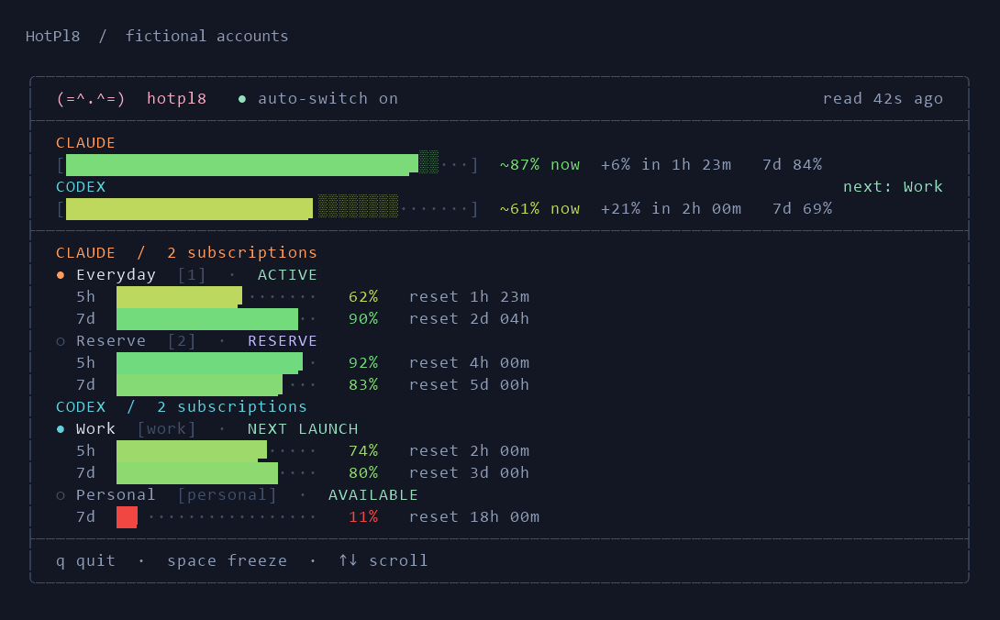
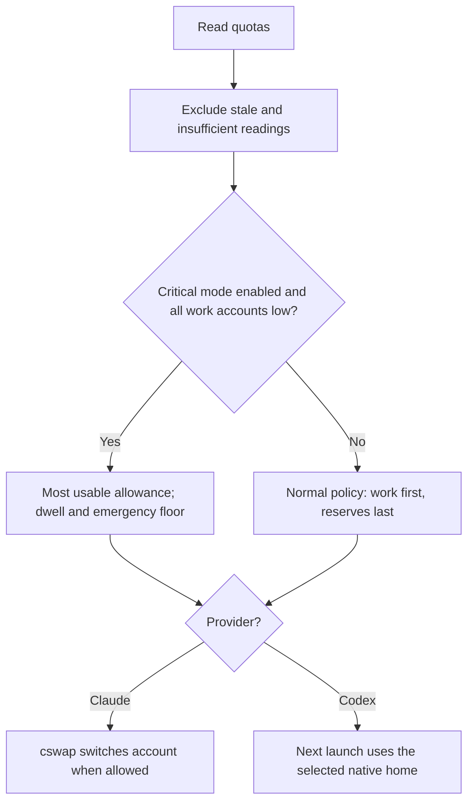

# HotPl8: usage-limit monitor and account switcher for Claude Code and Codex

[](https://github.com/Mmore35/hotpl8/actions/workflows/ci.yml)

HotPl8 is a local, open-source tool for people who use more than one Claude Code or OpenAI Codex subscription account. It reads the five-hour and weekly usage limits of every Claude (Pro, Max, Ultra) and ChatGPT/Codex (Plus, Pro) account you sign in, shows them together in a terminal dashboard, and chooses the account that has usable allowance left. It can switch Claude Code to that account, start Codex in it, and continue a conversation in an app such as T3 Code after it stopped on a usage limit. It runs on Windows and macOS and is MIT-licensed.



## What it does

- **Reads usage limits from the provider tools.** Claude readings come through [claude-swap](https://github.com/realiti4/claude-swap) (`cswap`); Codex readings come from the Codex app-server's own rate-limit request, run in each account's home. The five-hour, weekly and model limits are the provider's reported percentages and reset times, not estimates from local chat logs.
- **Shows one "Available now" bar per provider.** The bar pools every readable account, sized by plan in weeks of the smallest paid plan (Claude Pro 1, Max 5, Ultra 10; Codex Plus 1, Pro 5x 5, Pro 20x 20), so a large plan counts for more than a small one. A patterned extension shows the next refill within 24 hours. Each account's limits, resets and weekly pace are listed below. See [the provider overview](docs/provider-overview.md).
- **Chooses an account by a policy you set.** It leaves out stale or missing readings, keeps reserve accounts behind work accounts, and orders the rest by soonest reset or your preference. An opt-in critical mode handles the case where every work account is low. `hotpl8 explain` prints the reasons for the last choice.
- **Acts on that choice.** For Claude Code, `cswap` switches the signed-in account when policy allows it. For Codex, `hotpl8 codex` launches native Codex in the selected account's own home; existing sessions keep their account.
- **Continues after a usage limit.** When a conversation run by an app such as T3 Code stops on a limit, HotPl8 sends it one `Automated message: continue.` once a usable account is in place. Interactive terminal sessions are not covered. See [automatic continue](docs/plans/automatic-continue.md).
- **Optionally warms idle Claude accounts.** Off by default. A small request starts a cold account's five-hour window earlier. Warming uses quota and does not raise any limit.
- **Works with agents.** A versioned JSON command (`hotpl8 agent`) and a local stdio MCP server (`hotpl8 mcp`) let coding agents read account readiness, connect accounts and pause automation. See [the agent API](docs/agent-api.md).

Day-to-day controls (rename, reserve, disable, park, pause, work hours, weekly pace, a Windows tray, Claude sign-in expiry warnings) are in [account operations](docs/operations.md).

## What sets it apart

Other tools share some of these points; the [next section](#how-it-relates-to-other-tools) says which. Together they describe how HotPl8 is built.

- **Several accounts, two providers, one set of rules.** Claude Code and Codex accounts are read, ranked and shown side by side by the same decision code.
- **Totals weighted by plan.** The pooled bar counts a Max account as five Pro accounts and an Ultra as ten, and caps a five-hour window by what is left of its week in the same units, so the total is in plan-sized units rather than an average of percentages. It is an estimate, marked `~`. See [capacity](docs/capacity.md).
- **A policy, not only "most left".** Work and reserve accounts, preference or soonest-reset order (plus experimental weekly-expiry and balanced orders), switch hysteresis, work hours and daily attempt limits for prompts, and an opt-in critical mode. Each collection records why it chose, and `scripts/replay.ps1` compares orderings over saved snapshots.
- **It reads what the provider reports.** Percentages and reset times come from the native tools, not from counting tokens in local logs.
- **Continue after a limit, on both providers.** Claude Code conversations run by an app continue through a `StopFailure` hook; Codex conversations in T3 Code continue through the bridge, including when only a sub-agent hit the limit.
- **Opening the dashboard costs nothing.** The dashboard, `status` and the tray read a cached snapshot. They start no provider process, send no prompt and change no account. A background collector wakes once a minute and reads each provider on its own schedule, normally every five minutes.
- **Native sign-in stays native.** Claude Code, claude-swap and Codex keep their own logins. HotPl8 never asks you to paste a credential and does not store provider tokens in its state, and Codex accounts stay in separate homes so a launch or resume cannot use another account's login.
- **Local only.** No telemetry, no hosted service and no network listener. See [privacy](PRIVACY.md).
- **Every action can be turned off.** A new installation switches accounts and continues stopped conversations; warming stays off. `mode: monitor` turns every action off and leaves a read-only dashboard.
- **Checked updates.** Installations can follow tested `main` packages that CI attests and that the installer checks by SHA256 before running, with rollback. See [delivery](docs/delivery.md).

## How it relates to other tools

HotPl8 sits between usage trackers, which report limits or token use, and account switchers, which move a login from one account to another. The descriptions below come from each project's own README as of November 2026 and may have changed since.

| Project | What it is | How HotPl8 relates |
|---|---|---|
| [claude-swap](https://github.com/realiti4/claude-swap) | Claude Code multi-account CLI with a 5h/7d dashboard and automatic switching | HotPl8 uses it for Claude readings and switches, and adds Codex accounts, plan-weighted totals and its own selection policy |
| [ccusage](https://github.com/ccusage/ccusage) | Token and cost reports from local agent logs | Different data: HotPl8 reads the provider's limit percentages and does not estimate cost |
| [Claude Code Usage Monitor](https://github.com/Maciek-roboblog/Claude-Code-Usage-Monitor) | Terminal monitor for Claude Code usage, combining local estimates with official limit data | Claude only and no switching; HotPl8 pools several accounts and covers Codex |
| [ccstatusline](https://github.com/sirmalloc/ccstatusline) | Configurable Claude Code statusline with 5h and weekly usage widgets | Shows the current session inside Claude Code; HotPl8 is a separate dashboard across accounts |
| [CodexBar](https://github.com/steipete/CodexBar) | macOS menu bar app, with a Linux app, showing limits for Codex, Claude and many other providers | Covers more providers; HotPl8 is a terminal dashboard that also chooses and switches accounts, and runs on Windows |
| [ccswap](https://github.com/errhythm/ccswap) | Account switcher for Claude Code, Codex and Antigravity with best-account choice, auto-switching and optional warming | Closest in scope. HotPl8's emphasis is plan-weighted totals, reserve and critical-mode policy, automatic continue, the agent API and T3 Code integration |
| [codex-switcher](https://github.com/Lampese/codex-switcher) | Codex desktop app with account switching, warm-up and recovery of quota-stopped chats | Codex only; HotPl8 covers Claude Code too, from the terminal |

If you only need to see one Claude account's usage, a statusline or a single-provider monitor is simpler. HotPl8 is meant for several subscriptions that should be used in a planned order.

## Supported platforms and requirements

| | Windows | macOS |
|---|---|---|
| Status | Primary platform | Candidate, macOS 14 or later |
| Runtime | Windows PowerShell 5.1, built in | PowerShell 7.5+; `start.sh` installs it if missing |
| Background collection | Per-user scheduled task | Per-user LaunchAgent |
| Tray | Optional | Not available |
| T3 Code integration | Optional, Node 22+ | Through [Mac delivery](docs/macos-delivery.md#t3-uses-ordinary-codex) |

Linux is not supported. For Claude accounts you need Claude Code and claude-swap (Python 3.12+); for Codex accounts, the Codex CLI. Setup offers to install missing provider tools for your user. No administrator rights are needed. Tested versions and open limits are in [compatibility](docs/compatibility.md).

## Quick start

On Windows, download [`get.ps1`](get.ps1), read it, then run it in PowerShell:

```powershell
powershell -NoProfile -ExecutionPolicy Bypass -File .\get.ps1
```

On macOS, download [`get.sh`](get.sh), read it, then run:

```bash
bash get.sh
```

Each one downloads the latest `main` package that passed CI on both platforms, checks its checksums and starts setup. From an extracted package or a source checkout, run `start.ps1` on Windows or `bash start.sh` on macOS instead.

Setup reuses an existing native sign-in or opens the provider's login, enrolls the account, registers background collection and opens the dashboard. One account is enough. Then:

```powershell
hotpl8            # dashboard (q to quit)
hotpl8 add        # connect another Claude or Codex account
hotpl8 explain    # why the current account was chosen
hotpl8 doctor     # offline setup check
```

[Setup guide](docs/install.md) · [Connecting accounts](docs/onboarding.md) · [All commands](docs/usage.md) · [Configuration](docs/configuration.md) · [Troubleshooting](docs/troubleshooting.md)

## How it chooses an account



HotPl8 decides; cswap carries out Claude switches, and native Codex launches in the selected home. Warming is a separate, guarded decision. [Architecture: ranking, warming and credential flow](docs/architecture.md) · [Capacity and critical mode](docs/capacity.md).

## T3 Code integration

The optional [Codex account routing for T3 Code](docs/t3-integration.md) makes T3's ordinary Codex provider use HotPl8's account choice: new turns and helper commands run on an enrolled account with allowance left, while conversation state stays in T3's existing home. Setup runs with T3 closed, and removal restores the original configuration.

## Status

HotPl8 is pre-release (`0.2.0-rc.1`). Account switching, automatic continue, warming and the T3 integration are experimental; Codex warming is not available. Native provider tools can change their contracts, so offline tests show local behavior only. Claude automation goes through claude-swap, which has not been established as an Anthropic-approved integration; read the [provider boundaries](docs/compatibility.md#provider-boundaries) before turning automation on.

The older [v0.1.0-rc.1 Windows download](https://github.com/Mmore35/hotpl8/releases/tag/v0.1.0-rc.1) uses [its own manual instructions](https://github.com/Mmore35/hotpl8/blob/v0.1.0-rc.1/docs/install.md) and predates guided setup.

## Documentation

All guides are listed in the [documentation index](docs/README.md). Start with [install](docs/install.md), [commands](docs/usage.md) and [account operations](docs/operations.md); contributors start with [how HotPl8 works](docs/architecture.md) and [contributing](CONTRIBUTING.md).

## Development

HotPl8 is PowerShell around a compiled Rust program (`native/`) that holds every account rule, the collector and the dashboard. Tests are offline and use fictional accounts. [Contributing](CONTRIBUTING.md) · [Architecture and source map](docs/architecture.md) · [Add a provider](docs/adding-a-provider.md) · [Regenerate the screenshots](docs/screenshots.md). For a little color, run `hotpl8 nyan`.

[Report a bug](https://github.com/Mmore35/hotpl8/issues) · [Privacy](PRIVACY.md) · [Report a vulnerability](SECURITY.md) · [MIT license](LICENSE) · [Third-party notices](THIRD_PARTY_NOTICES.md)

Independent project; not affiliated with Anthropic or OpenAI.
